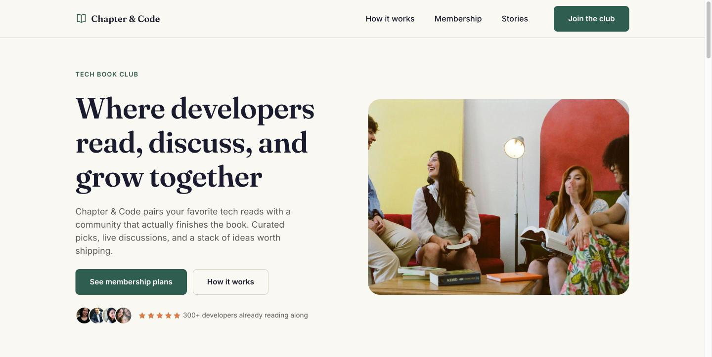
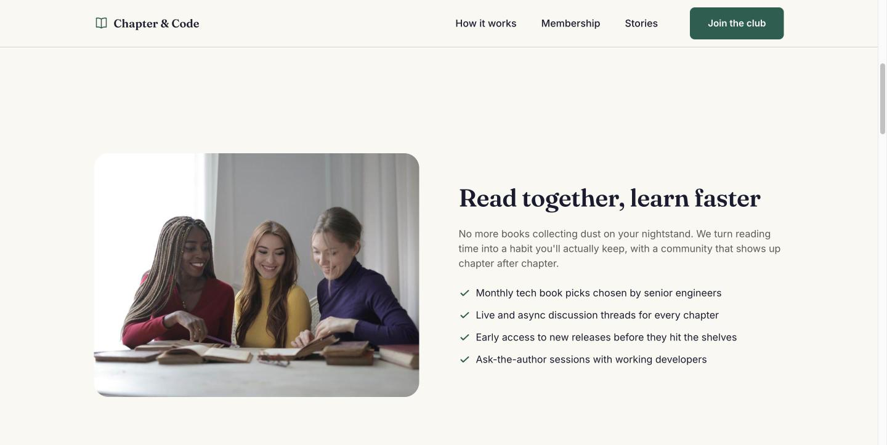
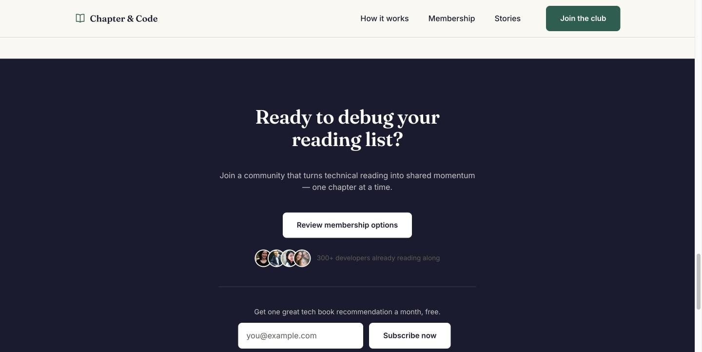

# Chapter & Code — Tech Book Club Landing Page

A portfolio project: a fully responsive landing page for a fictional tech book club, built with plain HTML5, Sass, and vanilla JavaScript.

🔗 **Live demo:** _add your GitHub Pages / Netlify link here once deployed_

## About this project

This page is **inspired by** Frontend Mentor's [Tech Book Club Landing Page](https://www.frontendmentor.io/challenges/tech-book-club-landing-page-fZQidjHU73) challenge — specifically its section structure (hero, feature highlights, pricing tiers, testimonial, final CTA with newsletter signup, footer). That challenge is a **Pro-only** challenge, so the official Figma file, copy, and photography weren't available to build from. Everything here — copy, color palette, typography, and photography — is **original**, not a clone.

> Photography is sourced from [Pexels](https://pexels.com), free to use under the [Pexels License](https://www.pexels.com/license/) (no attribution required). Photo credits: [Damian Santos](https://www.pexels.com/photo/35203998/) (hero), [Andrea Piacquadio](https://www.pexels.com/photo/3884170/) (feature), [Pexels contributor](https://www.pexels.com/photo/9432426/) (feature), and four individual portrait photographers (avatars).

## Screenshots

| Hero                                               | Feature                                                  | Final CTA & footer                                         |
| -------------------------------------------------- | -------------------------------------------------------- | ---------------------------------------------------------- |
|  |  |  |

_Tablet screenshots to add once reviewed on a real device — the layout is fully responsive (verified at mobile and desktop widths; see breakpoints below)._

## Built with

- Semantic HTML5
- Sass (7-1-lite architecture, BEM naming, CSS custom properties for design tokens)
- Vanilla JavaScript (mobile nav toggle, newsletter form handling — no framework, no build step beyond Sass compilation)
- [Fraunces](https://fonts.google.com/specimen/Fraunces) + [Inter](https://fonts.google.com/specimen/Inter) via Google Fonts
- Prettier, ESLint, Stylelint

## What I practiced / focused on

- **Mobile-first responsive design** with three breakpoints (768px / 1024px / 1280px) matching how each section's layout changes across devices
- **CSS architecture**: Sass partials organized by section/component, BEM naming to avoid specificity conflicts, design tokens as CSS custom properties so the dark final-CTA section can cleanly override colors
- **Accessibility**: distinct `:hover` and `:focus-visible` states on every interactive element, semantic landmarks (`header`, `nav`, `main`, labelled `section`s, `footer`), accessible mobile nav toggle (`aria-expanded`, closes on `Escape`), `blockquote`/`cite` for the testimonial, real (visually-hidden) labels on the newsletter input
- **Image strategy**: explicit `width`/`height` to avoid layout shift, `loading="eager"`/`fetchpriority="high"` on the likely LCP hero image and `loading="lazy"` elsewhere
- **Tooling restraint**: deliberately skipped a bundler, Vitest, Playwright, and Storybook — a one-page static site has no component logic or component library complex enough to justify them

## Running locally

```bash
npm install
npm run sass:watch   # compiles css/scss → css/main.css on change
npm run serve        # starts a local dev server with live reload
```

Other scripts:

```bash
npm run sass:build   # one-off compressed build
npm run format       # Prettier
npm run lint:css     # Stylelint
npm run lint:js      # ESLint
```

## Project structure

```
index.html
css/scss/            # Sass source, organized by abstracts / base / components / sections
js/main.js           # mobile nav toggle + newsletter form handling
assets/images/       # photo placeholders (see "About this project") + avatars
docs/screenshots/    # README screenshots
```

## Credits

- Layout pattern inspired by Frontend Mentor's [Tech Book Club Landing Page](https://www.frontendmentor.io/challenges/tech-book-club-landing-page-fZQidjHU73) challenge.
- Photography from [Pexels](https://pexels.com) — free to use, no attribution required under the [Pexels License](https://www.pexels.com/license/).
